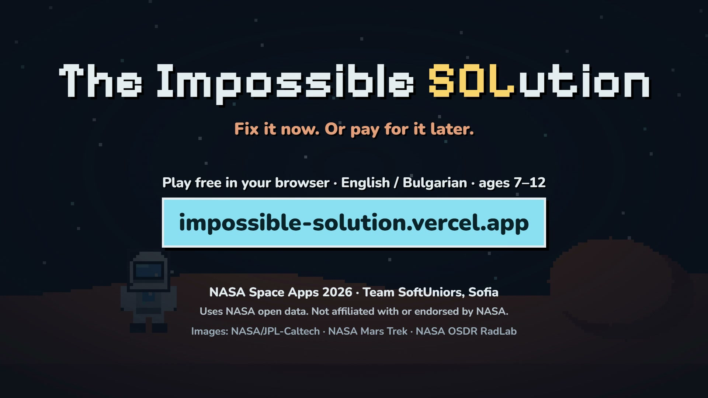

<div align="center">

# Can you keep 3 astronauts safe through a real Mars solar storm?

**The Impossible SOLution** is a browser game for kids aged 7–12 and their classrooms, in English and Bulgarian, made in Sofia, Bulgaria by team SoftUniors.

It turns real NASA storm and radiation data into hard choices, so kids learn that on Mars every decision costs something and the cost can arrive days later.

<a href="https://impossible-solution.vercel.app"><strong>▶ Play now: https://impossible-solution.vercel.app</strong></a> ·
<a href="#quick-start">🚀 Quick start</a> ·
<a href="#nasa-data">🛰️ NASA data</a> ·
<a href="docs/README.md">📚 Docs</a> ·
<a href="CONTRIBUTING.md">🤝 Contributing</a> ·
<a href="CHANGELOG.md">📝 Changelog</a>

[](https://github.com/YYN192/impossible-solution/actions/workflows/ci.yml)
[](https://github.com/YYN192/impossible-solution/actions/workflows/deploy.yml)
[](https://github.com/YYN192/impossible-solution/releases)
[](LICENSE)
[](https://www.spaceappschallenge.org/)


<a href="docs/media/launch-video.mp4"></a>

<a href="docs/media/launch-video.mp4"><strong>▶ Watch the 30-second launch video</strong></a>

</div>

## What is it?

You run a Mars base for 3 sols (a sol is one day on Mars). There is never enough power or people for every job, so every choice costs something. At the end, a domino chain shows which of your choices caused each problem.

Built for the NASA Space Apps Challenge 2026 ("Build a Junior Astronaut Mission Trainer") by team **SoftUniors**, Sofia.

## Key features

- 🧮 **Real trade-offs.** A pure, deterministic three-sol simulation of power, air, food and radiation.
- 🔗 **Domino chain.** The final report traces each outcome back to the player's choices.
- 🛰️ **Real NASA data, honestly labelled.** An offline-first data layer with **LIVE** and **SAVED DATA** badges.
- 🔎 **Where our numbers come from.** A Data Sources screen separates real measurements from labelled game numbers.
- 🎬 **Repeatable demo.** `?demo=1` replays the same five-link story every time, from bundled data.
- 🌍 **English and Bulgarian**, keyboard and touch, no login, works on phones.

## Quick start

```bash
git clone https://github.com/YYN192/impossible-solution.git && cd impossible-solution && npm install && npm run dev
```

Needs Git and Node.js 22 LTS (20.19+ works). Then open http://localhost:5173/impossible-solution/.

## How to play

1. Walk to the glowing **mission console** (arrow keys / WASD, or tap).
2. Give each astronaut one job for the sol. Watch the bars change before you commit.
3. Sleep, see what happened, repeat for 3 sols, then follow the dominoes.

### URL modes

| Mode         | Behaviour                                                                                 |
| ------------ | ----------------------------------------------------------------------------------------- |
| `?offline=1` | Never uses the network; reads bundled NASA/CSA snapshots only                             |
| `?demo=1`    | Runs the deterministic video scenario and implies offline mode                            |
| `?sun=today` | Uses current Mars-bound DONKI forecasts when available, otherwise shows the saved mission. Also the main-menu choice "Today's real Sun" |
| `?lang=bg`   | Starts in Bulgarian                                                                       |

`?demo=1&offline=1` is the regression-tested recording URL. It always uses the same May 2024 storm data, starting state and three-sol plan.

## NASA data

The game uses InSight's dusty solar panels, the 20 May 2024 solar storm that Curiosity measured on Mars, and DONKI space-weather forecasts. Every source is listed in the in-game **Where our numbers come from** screen and in [`CREDITS.md`](CREDITS.md). Saved data is never labelled live.

## Hosting and backend

Two hosts build the same code:

| Host | URL | Base path | Backend |
| --- | --- | --- | --- |
| Vercel (main) | https://impossible-solution.vercel.app | `/` (`BASE_PATH=/`) | yes: `api/` functions, `VITE_API_BASE=/api` |
| GitHub Pages (fallback) | https://yyn192.github.io/impossible-solution/ | `/impossible-solution/` (default) | no: the browser calls DONKI directly with DEMO_KEY, else saved data |

Backend endpoints (`api/`, Vercel Node functions, allowlisted, never an open proxy). Each answers
`{source: "live" | "cached", fetchedAt, upstream, data}` (`stale: true` when it is the last good copy), or a JSON error (400 bad input, 502 NASA error, 504 timeout):

| Endpoint | Upstream | CDN cache |
| --- | --- | --- |
| `GET /api/donki/:type?startDate&endDate` (`CME`, `WSAEnlilSimulations`, `GST`, `FLR`, `SEP`, `notifications&type=`) | CCMC DONKI (no key) first, then `api.nasa.gov/DONKI` with our key; max 60-day window | 1 h + SWR |
| `GET /api/osdr/search?term&size` (size 1–25) | `osdr.nasa.gov/osdr/data/search` | 1 day + SWR |
| `GET /api/dsn/mars` | DSN Now `dsn.xml` → Mars spacecraft + round-trip light time | 60 s |
| `GET /api/status` | which upstreams answer now, and whether a personal key is set | 5 min |

The NASA key lives only in Vercel → Settings → Environment Variables → `NASA_API_KEY` (server-side; DEMO_KEY if unset).
`?offline=1` and `?demo=1` never call `/api`. Code: `api/_lib/nasa.ts` (tests next to it).

## Project map

To refresh the saved data, see [Contributing](CONTRIBUTING.md#5-commands-and-data).

## Privacy

No login, no analytics, no cookies. The browser stores only your language, sound settings and a cache of NASA data. The only network calls go to NASA servers, and `?offline=1` turns those off too.

## Contributing

Bug or idea? [Open an issue](https://github.com/YYN192/impossible-solution/issues/new/choose). Questions go to [Discussions](https://github.com/YYN192/impossible-solution/discussions). Team setup, workflow, commands and the project map are in [`CONTRIBUTING.md`](CONTRIBUTING.md).

## License

[Apache-2.0](LICENSE). Data sources, libraries and AI use: [`CREDITS.md`](CREDITS.md) and [`docs/ai-usage-log.md`](docs/ai-usage-log.md).
Uses NASA open data. Not affiliated with or endorsed by NASA.
