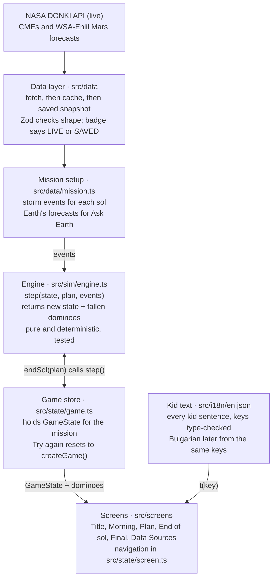

# The Impossible SOLution — Project Documentation

Last updated 14 Nov 2026 · exported from the team's Claude Doc

## Overview

The Impossible SOLution is a browser game for kids aged 7–12 in which they run a Mars base for 3 sols and learn that every choice costs something. A sol is one day on Mars. There is never enough power or people for every job, and at the end a domino chain shows which choice caused each problem.

| | |
| --- | --- |
| Play it | [yyn192.github.io/impossible-solution](https://yyn192.github.io/impossible-solution/) |
| Source code | [github.com/YYN192/impossible-solution](https://github.com/YYN192/impossible-solution) |
| Challenge | NASA Space Apps Challenge 2026: Build a Junior Astronaut Mission Trainer |
| Team | SoftUniors, Sofia |
| Audience | Kids 7–12, in class or at home; one mission takes about 8 minutes |
| Licence | Apache-2.0 |

The one sentence a class should leave with: **On Mars, every choice costs something, and help from Earth can't always arrive in time.**

The game uses real NASA data: InSight's dusty solar panels, the 20 May 2024 solar storm that Curiosity measured on Mars, and DONKI space-weather forecasts. It uses NASA open data and is not affiliated with or endorsed by NASA.

## How to play

Each sol, the player gives 3 astronauts 5 possible jobs, so 2 jobs are always left undone, and each skipped job costs something later.

**One sol, step by step**

1. **Morning report.** The first line is the domino that fell overnight, with icons (for example "⚡↓ because you skipped the panels"). At most one more line follows: a storm, or Earth's answer.
2. **Plan.** Tap an astronaut, then tap a job. Each placement previews its cost on the bars, plus a small domino for each skipped job ("🧽✗ → ⚡↓ tomorrow").
3. **End of sol.** The night runs: the air machine uses power, storms add space rays, and the bars move (no animation with reduced motion).
4. After sol 3, or earlier if the base fails: the **final screen**.

**The bars**

- **Power** ⚡: solar panels make it; dust lowers it.
- **Air** 🫧: the air machine uses power every night; no power means the air drops.
- **Space-ray meter** ☢️: the crew's radiation dose; lower is better.
- **Food** 🥬: a small counter fed by the greenhouse.

**The jobs**

| Job | Cost today | If done | If skipped |
| --- | --- | --- | --- |
| 🧽 Clean solar panels (outside) | 1 worker, some space rays | Full power tomorrow | Dust builds: tomorrow's power about a third lower |
| 🥬 Run greenhouse lights | 1 worker, 2 power | +1 food | −1 food; food at 0 makes one astronaut too tired next sol |
| 🛡️ Build up the shelter | 1 worker, 1 power | Space rays halved today and tomorrow | No cover if a storm hits |
| 📡 Ask Earth | 1 worker, 1 power | Next morning: dust forecast and storm-cloud warning | You plan tomorrow blind |
| 🔬 Science trip (outside) | 1 worker, some space rays | +1 science | No science |

All job numbers are game numbers, chosen so the game is fair; real anchors are in the next section.

**The end of a mission**

- The **domino chain** follows each problem back to its first cause, for example: sol 3 astronaut too tired ← sol 2 food ran out ← sol 2 power low ← sol 1 nobody cleaned the panels.
- **1–3 stars**: crew safe (dose under the limit), base running (no bar hit 0), science goal reached. The best score is saved on the device.
- **Try a different plan** restarts from sol 1 with the same start. Losing is never punitive: "Mission ended early. Here is what caused it."

## The science and NASA data

Every real number in the game has a NASA source; every other number is labelled "game number" on the in-game Data Sources screen. The single source of truth in code is `src/data/sources.ts`.

| Real data | Real value | Used in the game for |
| --- | --- | --- |
| [Curiosity RAD, 20 May 2024 storm (JPL)](https://www.jpl.nasa.gov/news/nasa-watches-mars-light-up-during-epic-solar-storm/) | 8.1 mGy absorbed dose from one storm | How far the space-ray meter jumps in a particle burst |
| [Curiosity RAD surface baseline (Hassler et al., Science 2014)](https://doi.org/10.1126/science.1244797) | 0.21 mGy/day (0.64 mSv/day) | The normal daily rise; the burst equals about 39 normal days |
| [InSight dust and solar power (JPL)](https://www.jpl.nasa.gov/news/nasas-insight-waits-out-dust-storm/) | 425 → 275 Wh per sol in a 2022 dust storm (about −35%) | Skipping panel cleaning lowers tomorrow's power by about a third |
| [DONKI CME 2024-05-20T05:36:00-CME-001](https://ccmc.gsfc.nasa.gov/DONKI/view/CME/31034/-1) | The 20 May 2024 eruption, about 1,900–2,700 km/s | The storm on sol 2 of the main mission |
| [DONKI WSA-Enlil forecast](https://ccmc.gsfc.nasa.gov/DONKI/view/WSA-ENLIL/31103/-1) | 23 May 2024 CME forecast to brush past Mars on 28 May, ~11:30 UTC | Ask Earth's "a storm cloud is coming" answer |
| [NSSDC Mars fact sheet](https://nssdc.gsfc.nasa.gov/planetary/factsheet/marsfact.html) | Earth–Mars light delay 3–22 minutes one way | Ask Earth wording |

**Two kinds of storm, both real**

- **Particle burst**: arrives tens of minutes after the eruption, so no warning from Earth can beat it. Built on the 20 May 2024 storm Curiosity measured.
- **Storm cloud (CME)**: takes days to reach Mars, so Earth can warn you, but only if a worker spent the day on Ask Earth. Built on DONKI's WSA-Enlil Mars forecast.

Ask Earth wording (locked): "Your message takes about 12 minutes to reach Earth. Scientists study it overnight. Their answer is waiting for you in the morning."

**Live and saved data**

- The game fetches DONKI live when online and falls back to a bundled snapshot (fetched 14 Nov 2026) when offline or when the API fails.
- A badge always says honestly which it is: LIVE or SAVED DATA. Saved data is never called live.
- A live CME is never mapped to a Mars dose. The optional "Today's Sun" mission uses only live CMEs forecast to reach Mars; with none in 30 days the game says "The Sun is quiet toward Mars this month" and uses the May 2024 mission.

**What this game simplifies**

- A real base has more than 3 astronauts and many more jobs.
- Sols are short rounds: a storm cloud that takes days is squeezed into one or two sols.
- Job costs, food and the size of each bar are game numbers.
- The space-ray meter uses game units; only the size of a storm compared with a normal day is real.
- Earth's dust forecast is made up; the storm-cloud warning is a real computer forecast, not a measurement.
- Normal Mars radiation was measured in 2012–13; the big storm happened in 2024.

Kid screens never show "DONKI", "mGy" or "CME"; they say "sun storm", "storm cloud" and "space-ray meter". Real terms appear only in the Data Sources screen and "What's this?" tooltips.

## How it is built

The game is a static single-page app with no backend: React 19 + TypeScript on Vite, Zustand for state, Zod for API data, i18next for text, Vitest for tests, hosted on GitHub Pages.



NASA data flows down into storm events; the engine turns each sol's plan into a new state and the dominoes that fell; screens read that state and take every sentence from `en.json`. The game store (`src/state/game.ts`) came in with pull request #29.

**Project map**

| Path | What lives there |
| --- | --- |
| `src/sim/types.ts` | The shared contract and the job cause/effect table (read this first) |
| `src/sim/engine.ts` | `createGame()`, `step()`, `stars()` |
| `src/data/http.ts` | `getJson`: fetch with retries and timeout, local cache, snapshot fallback |
| `src/data/donki.ts` | DONKI data shapes and the Mars-only filter |
| `src/data/mission.ts` | Builds the May 2024, Today's Sun and demo missions |
| `src/data/sources.ts` | Every real number with its source, and the simplifications list |
| `src/data/flags.ts` | URL switches: `?demo`, `?offline`, `?sun=today` |
| `src/data/snapshots/` | Saved NASA data, so the game works offline |
| `src/state/` | Zustand stores: screen navigation, mission, game |
| `src/screens/` | Title, morning report, plan, end of sol, final chain, Data Sources; `DominoCard`, `DataChip` |
| `src/components/` | `DataBadge` (LIVE / SAVED DATA); `WhatsThis` tooltip |
| `src/i18n/` | `en.json`, typed keys, `tDynamic` for keys that arrive at runtime |
| `scripts/snapshot.mjs` | Re-downloads the NASA snapshots |

**The engine contract** (`src/sim/types.ts`, owner Aleksandar; changes agreed in the team chat first)

- `step(state, plan, events)` returns `{ state, fell }`. It must be pure and deterministic: the same input always gives the same output.
- A `Plan` maps each astronaut (`a1`–`a3`) to a job; unassigned astronauts are idle.
- A `Domino` has an `id` such as `sol1-panels-skipped`, the `sol`, an `icon`, a `textKey` into `en.json`, and `causeIds` that point to earlier dominoes. The final screen follows `causeIds` back to the first cause.
- A `StormEvent` (particle burst or storm cloud) comes from the data layer with its `captionKey` and a `DataRef` source.
- `MISSION_SOLS = 3`. The numbers in `JOBS`, `NIGHT` and `DOSE` are game numbers, except the burst size, which keeps the real ratio of 8.1 mGy to 0.21 mGy per day (about 39 normal days).

**Text**: screens call `t("morning.heading")`; keys are typed against `en.json`, so a wrong key fails the build. Keys that arrive at runtime (domino and storm captions) go through `tDynamic`, which shows the key instead of crashing if it is missing.

## Running it locally

You need Git and Node.js 22 LTS (20.19+ also works); then four commands start the game at http://localhost:5173/impossible-solution/.

```bash
git clone https://github.com/YYN192/impossible-solution.git
cd impossible-solution
npm install
npm run dev
```

| Command | What it does |
| --- | --- |
| `npm run dev` | Run locally with live reload |
| `npm test` | Run the Vitest tests once |
| `npm run build` | Type-check and build into `dist/` (what gets deployed) |
| `npm run preview` | Serve the built `dist/` locally |
| `npm run lint` | Lint with oxlint |
| `npm run snapshot` | Re-download the NASA data snapshots (needs a NASA key) |

**URL switches**

- `?offline=1`: no network; saved NASA data only.
- `?demo=1`: a fixed, seeded mission for the demo video (implies offline).
- `?sun=today`: the optional "Today's Sun" mission from live DONKI data.

**NASA key** (only for `npm run snapshot`): copy `.env.example` to `.env` and put a free key from [api.nasa.gov](https://api.nasa.gov) after `NASA_API_KEY=`. Never commit `.env`, and never put the key in a `VITE_*` variable, which would ship it to browsers.

**Deploy**: every merge to `main` builds and publishes to GitHub Pages in about a minute (`.github/workflows/deploy.yml`). Every pull request runs build and tests first (`.github/workflows/ci.yml`), both on Node 22.

**Troubleshooting**

- `Cannot find module` or `Failed to resolve import` after pulling: run `npm install`.
- Still broken: delete `node_modules` and run `npm install` again.
- Tests fail with `Cannot find dependency 'jsdom'`: the project folder path contains `#`; move it to a path without one.

## Quality, accessibility and privacy

`main` must always build and pass its tests: `npm run build && npm test` runs before every push, and the pull-request check runs both again.

**Tests (Vitest + Testing Library + MSW)**

| Area | What the tests prove |
| --- | --- |
| Engine (`src/sim/`) | `step()` is pure and deterministic; a 3-link domino chain exists inside 3 sols; several 2–3 star plans and at least one 1-star plan exist; no plan is free and no single job is the best pick every time; bars stay within 0–10; the kid text matches the game numbers |
| Data layer (`src/data/`) | Live fetch, retry on 429, timeout, cache, snapshot fallback, offline mode, API key never cached; science-check wording |
| Screens and state | Navigation, morning report picks the fallen domino first, badge never says LIVE for saved data |
| Copy rules (`src/i18n/en.copy.test.ts`) | No DONKI/mGy/CME/X-ray on any screen, kid sentences of 12 words or fewer, locked Ask Earth wording |

On `copy/text`: 154 tests passing.

**Accessibility**

- Tap targets are at least 44 px; everything works with keyboard and touch, with visible focus.
- `prefers-reduced-motion` turns off domino and bar animations.
- Icons are decoration (`aria-hidden`); the sentence beside each carries the meaning for screen readers.
- `<html lang>` follows the chosen language.
- "What's this?" tooltips open by tap or keyboard and close with Escape.

**Kid text rules**

- Every kid-facing sentence lives in `src/i18n/en.json` (Bulgarian later from the same keys); text keys are type-checked, so a typo fails the build.
- Short sentences a 7-year-old can read; any science word is explained.
- Never "30 chest X-rays"; say "as much radiation as more than a month on Mars, from one storm".

**Privacy and safety**

- No login, no accounts, no data collected. The only thing stored is the best star score, in the browser's local storage.
- No photos, faces or voices of team members (all under 18) in the video or project page.
- No NASA logos anywhere.

**Known issues**

- On Node 25 or newer, 14 data-layer tests fail because Node's built-in `localStorage` hides jsdom's. CI uses Node 22, so it is unaffected; the fix in `src/test/setup.ts` is on `copy/text`, not yet on `main`.
- The morning-report data chip shows the source label, which contains "DONKI WSA-Enlil" on a kid screen; it needs a kid-friendly label.
- The "What this game simplifies" text is hard-coded in `src/data/sources.ts`, so it cannot be translated yet.
- `public/favicon.svg` is still the Vite logo from the project template.

## Team and workflow

Five people each own one branch and one area of the code; work reaches the game only through a green pull request into `main`.

| Person | Branch | Owns |
| --- | --- | --- |
| Aleksandar (gate decider) | `sim/engine` | `src/sim/`: types, causal table, `step()`, engine tests |
| Yavor (backup decider) | `data/layer` | `src/data/`, `scripts/`, snapshots, badge, `?demo=1` / `?offline=1`, Data Sources screen, submission |
| Viktor | `ui/planner` | Plan screen: crew, 5 job cards, tap-tap, cost preview |
| Danislav | `ui/reports` | App shell, title, morning report, end of sol, final domino chain and stars |
| Nikolay P. | `copy/text` | `en.json` kid text, tooltips, simplifies card, `CREDITS.md`, AI log, icons |

**Work session**

1. `git switch <your-branch>`, `git pull`, `git fetch`, `git merge origin/main`, `npm install`.
2. Commit small steps every 30–60 minutes; `npm run build && npm test` before every push.
3. Open a pull request into `main`; merge when the check is green. The live site updates in about a minute.

**Gates (Sofia time)**

1. Sat 14:00: playable loop of 3 sols, deployed.
2. Sat 16:00: science check on all kid text and numbers.
3. Sat 18:00: real-kid playtest (age 7–12, guardian present, no recording).
4. Sat 19:00: MVP: stars and Best, final chain, Data Sources, badge, `?offline=1`, `?demo=1`.
5. Sat 23:00: feature and copy freeze; Bulgarian only from frozen English.
6. Sun 10:00–13:00: record the 30-second video from `?demo=1`; upload by 13:00.
7. Sun 14:00–16:00: pitch prep; 16:00 live finals.
8. Sun 20:00: global submission (hard deadline 23:59).

**Drop order if a gate slips**: prediction tap → "Today's Sun" live run → Bulgarian toggle → stars become pass/fail → teacher card becomes a static page. Never dropped: morning domino, Ask Earth, snapshot storm, Data Sources screen, LIVE/SAVED badge, `?demo=1` and `?offline=1`.

**Open issues and pull requests** (as of 14 Nov 2026, 14:00; closed so far: #1, #2, #4, #5, #12, #13, #14)

| # | Title | Owner | Priority |
| --- | --- | --- | --- |
| [#31](https://github.com/YYN192/impossible-solution/pull/31) | Pull request: kid text, tooltips, credits, AI log, this documentation | Nikolay P. | P0 |
| [#20](https://github.com/YYN192/impossible-solution/issues/20) | Fix registration: team event → Sofia | Yavor | P0 |
| [#21](https://github.com/YYN192/impossible-solution/issues/21) | Real-kid playtest Sat 18:00 | Yavor | P0 |
| [#15](https://github.com/YYN192/impossible-solution/issues/15) | Write all kid text in `en.json` | Nikolay P. | P0 |
| [#16](https://github.com/YYN192/impossible-solution/issues/16) | "What's this?" tooltips and simplifies card | Nikolay P. | P0 |
| [#9](https://github.com/YYN192/impossible-solution/issues/9) | Plan screen: 3 astronauts × 5 job cards | Viktor | P0 |
| [#10](https://github.com/YYN192/impossible-solution/issues/10) | Plan screen: cost preview and mini-dominoes | Viktor | P0 |
| [#7](https://github.com/YYN192/impossible-solution/issues/7) | Data Sources screen and simplifies card | Yavor | P0 |
| [#6](https://github.com/YYN192/impossible-solution/issues/6) | `?demo=1` seeded mission for the video | Yavor | P0 |
| [#3](https://github.com/YYN192/impossible-solution/issues/3) | Stars and Best score | Aleksandar | — |
| [#11](https://github.com/YYN192/impossible-solution/issues/11) | Record the demo video from `?demo=1` | Viktor | — |
| [#17](https://github.com/YYN192/impossible-solution/issues/17) | Keep credits and AI log up to date | Nikolay P. | — |
| [#22](https://github.com/YYN192/impossible-solution/issues/22) | Global submission and pitch prep | Yavor | — |
| [#18](https://github.com/YYN192/impossible-solution/issues/18) | Teacher card: lesson goal and 3 questions | Nikolay P. | stretch |
| [#19](https://github.com/YYN192/impossible-solution/issues/19) | Bulgarian translation from frozen English | Nikolay P. | stretch |
| [#8](https://github.com/YYN192/impossible-solution/issues/8) | Optional "Today's Sun" run from live DONKI | Yavor | stretch |

## Credits, licence and AI use

The project is open source under Apache-2.0; every library, asset, dataset and AI use is listed in `CREDITS.md` and `docs/ai-usage-log.md` on the same day it is added.

**Libraries**

| Library | Licence | Used for |
| --- | --- | --- |
| React, React DOM | MIT | User interface |
| Vite, @vitejs/plugin-react | MIT | Dev server and build |
| TypeScript | Apache-2.0 | Type-checked code |
| Zustand | MIT | Game and screen state |
| Zod | MIT | Checking the shape of NASA API data |
| i18next, react-i18next | MIT | All kid text from `en.json` |
| Vitest, jsdom, MSW, Testing Library, Prettier, oxlint | MIT | Tests and tooling (dev only) |

**Assets**: game icons are Unicode emoji drawn by each device's own emoji font. Original pixel-art sprites in `src/assets/pixel/` (title-screen vignette) are generated by `scripts/generate-pixel-assets.mjs`. No icon packs or fonts are downloaded. The favicon is the Vite template logo (MIT) and should be replaced before submission. No NASA logos are used.

**NASA data**: all datasets in the science section above; it uses NASA open data and is not affiliated with or endorsed by NASA.

**AI use** (required in the Space Apps submission; full log in `docs/ai-usage-log.md`)

| Who | Tool | What for |
| --- | --- | --- |
| Yavor | Claude Code (Claude Opus 5.5) + judge, kid-playtester and science-checker agents + an LLM council | Scaffold, concept scoring and v2 decisions, data layer, science-check fixes, engine spec tests |
| Aleksandar | Claude Code (Claude Opus 5.5) | Engine: tests first, then `step()`, stars, storm-cloud dose |
| Danislav | Claude Code (Claude Opus 5.5) | App shell, i18n setup, morning report, final screen and game store |
| Nikolay P. | Claude Code (Claude Opus 5.5) | Kid text, copy-rule tests, "What's this?" tooltips, credits, pitch deck, this documentation |

Every AI output was reviewed by the team member who committed it; the concept decisions are recorded in `docs/council/`.
